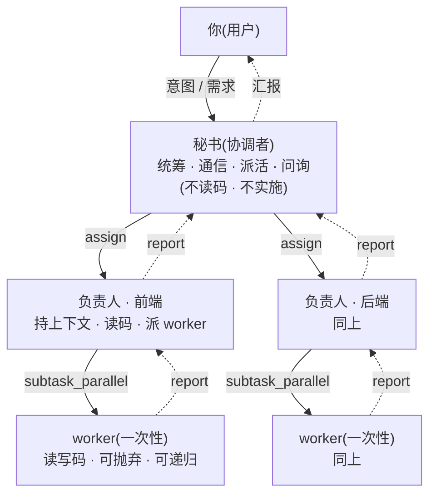
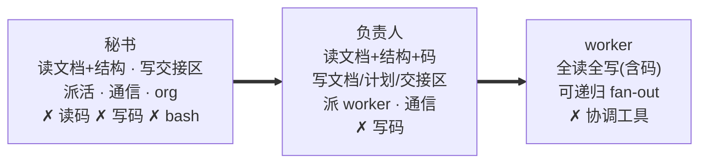

# 需求分析:随行协调者套件 + dsh 0.2.0-rc.2 迁移

> 范围:本次实现(dsh 0.1.1-rc.2 → 0.2.0-rc.2 迁移 + 随行协调者套件 6 插件)。
> **不是**整个 omp-2-dsh 仓库的完整需求(仓库还含 omp 能力迁移等其它内容)。
> 对应实现设计见 `DESIGN-COORDINATOR-SUITE.md`。

---

## 1. 背景与痛点

在 omp 的 vibe+advisor 模式下开发很顺手,但迁移到 dsh 后仍留有几类痛点,本套件针对性地解决:

| # | 痛点 | 需求 |
|---|---|---|
| 1 | worker 上下文太不重要,被随手杀掉;想要一层"负责人"角色,上下文像普通 agent 一样保留 | 持久负责人会话(只由用户关闭,上下文跨轮保留) |
| 2 | 并行处理多任务要开很多终端,彼此不知对方干了什么 | 任务板 + 会话间通信/可见 |
| 3 | rule 是弱提示,模型注意力一被任务带跑就违背 | 规则分提醒型与门禁型,门禁靠机制不靠措辞 |
| 4 | 公司弱模型,方案评审要跑 15 轮、冷上下文重复推导、问题循环 | 评审用干净上下文评审者,发现由负责人累积/过滤/回喂 |
| 5 | omp 只给 director read 工具、只能打字;多个问题一次涌回、回一个别的被顶掉 | 结构化、非阻塞、可乱序回答的问题面板 |
| 6 | 有时想先方案等我审批,有时想它自己跑;写出方案后才想起要审 | `--review` 后缀:逐任务设卡 |
| 7 | 想随时让某个会话成为秘书统领其它会话、绕过秘书直接跟负责人对话 | 会话间点对点通信 + 可提升协调者角色 |
| 8 | agent 看不到自己哪些任务没完成,也不能自动闭环/手动关掉 | 任务板工作集注入上下文 + 自动/手动闭环 |
| 9 | 任务可拆成多个独立点,但 agent 只会拆、不会拆完就并发执行 | 递归 fan-out + 并行执行(显式工具 + 可配闸) |

## 2. 迁移需求:dsh 0.1.1-rc.2 → 0.2.0-rc.2

现有 7 插件 pin `@deepseek-ai/dsh-*@0.1.1-rc.2`;最新为 `0.2.0-rc.2`(无 stable),落后 9 个版本、跨代升级。必须**一次性整体迁移**(dsh 包间等价 peer,混版本会双实例)。

**破坏性变更速查(14 组 + 4 改名,~70 调用点,6/7 插件):**

| 组 | 变更 | 影响 |
|---|---|---|
| D 装配 | cordis 4.0.1→4.0.4;`dsh-*` 必须迁 peerDependencies(否则命中旧副本双实例);删 `dsh-client-runtime`;新增 `dsh-util-values`;`dsh-agent-presets`→`dsh-agent-preset-registry` | 全部 |
| S 会话事件 | `Session.events` 删除(18 处)→ `seq`/`eventAt`/`snapshotEvents`(亦弃用);seq 品牌化 `SessionSeq`/`SessionLogOffset` | compact/advisor/read-write |
| M 消息词表 | `MessageSourceMap` 删通配 `plugin` kind;`tool-result` 块删除;`ToolResultMessage` role→`tool` | compact/advisor/read-write |
| A agent 生命周期 | `agent/session-start`→`agent/created`;`Context.agent` 删除;`Inbox.hasPending` 移出;`subagents.followup`→`sendMessage`;`listChildren` 行换代 | advisor |
| C 压缩 | `CompactionResult` 序号品牌化;checkpoint 标记值变更;`TokenMeasurement.heuristicTokens` 新增 | compact |
| P 设置 | `installSettingsSection`/`settingsNamespace` 删除 → Config `.volatile()` | vibe(删) |
| W 客户端 | `dsh-client-runtime` 整包删除;`settingsScope`→`configForms`;`sessions.open`→`retain` | mode-ui/vibe(删) |
| S8/M5 迁包改名 | `JsonValue`/`deepFreeze` 迁 `dsh-util-values`;`CallId`→`ToolCallId` | compact/read-write/advisor |

**不受影响(已核实)**:`ctx.fs`/`ctx.tools`(register/restrict/presentAs)/`ctx.systemPrompt.section`/`ctx.commands`/`ctx.agents`/`ctx.sandbox`/`Agent.followup·steer·inject`/`ctx.goals`/`startContinuable`/session-projection 契约 —— 签名逐字节未变,新套件核心机制不受拖累。

## 3. 新套件需求:6 插件 + 1 延后

| 插件 | 职责 | 关键机制 |
|---|---|---|
| `dsh-org` | 秘书/负责人层级 + 授权(manager/forbid) | `ctx.agents.create()/resume()` + `/org` 命令 + 会话面板 |
| `dsh-peers` | 进程内点对点通信 + 可提升协调者 | `ctx.sessions` 身份 + `peer/message` 事件 + 自建去重 |
| `dsh-task-board` | 需求级任务板 + 工作集/注意力 + 闭环/重开 | session-projection + `systemPrompt.section` |
| `dsh-review-gate` | `--review` 写路径闸 | `tools/pre-execute` → `ctx.approval`/`ctx.userQuestions` |
| `dsh-question-board` | 异步问题收件箱 | durable 事件 + 节点 |
| `dsh-orchestrator` | 需求-评审循环 + `subtask_parallel` | `ctx.goals` + `startContinuable` + 递归 fan-out |
| (延后) 模型路由 | vibe `fast/good` 两档扩展 | — |

**关键架构定论(访谈确认):**
- **进程内**通信,不做跨进程总线。
- **不替换 agent-loop**;评审/流程是 goal + 事件 + 会话驱动。
- 评审用**一次性干净上下文**评审者;业务判断/累积/过滤在**负责人**。
- **goal 只放在被派出的可抛弃子agent 里(一个需求一个),绝不落在秘书/负责人会话上**。
- `--review` ≠ plan-mode:保留全工具、只按**写作用域**设卡;dsh 无路径级 fence → 自建 `tools/pre-execute` 路径闸。
- 递归 fan-out:`subtask_parallel` 显式工具 + 三个可配闸(深度/总数/是否值得拆)。

## 4. 角色与权限需求

**三层角色架构(谁管谁、谁做什么):**

**角色靠工具集(能力)强制,不靠提示词** —— 上下文一长、注意力衰减,模型会忘角色、自己动手;不给它工具,它就没能力越界。

三层能力梯度:

| 能力 | 秘书 | 负责人 | worker |
|---|---|---|---|
| 读文档 | ✓ | ✓ | ✓ |
| 读结构(树/符号) | ✓ | ✓ | ✓ |
| 读代码正文 | ✗ | ✓ | ✓ |
| 写代码(`src/**`) | ✗ | ✗ | ✓ |
| 写文档/计划(`docs/**`) | ✗ | ✓ | ✓ |
| 写长任务书(交接区) | ✓ | ✓ | — |
| 派活(`subtask_parallel`/spawn) | ✓(派负责人) | ✓(派 worker/评审) | 递归时 ✓ |
| 通信(`peer_send`/`report`) | ✓ | ✓ | ✗ |
| 任务板(`task_*`) | ✓ | ✓ | ✗ |
| org(接管/禁止) | ✓ | ✗ | ✗ |
| 问用户(`ask_question`) | ✓ | ✓(经父) | ✗ |

**关键概念:**
- **"写" ≠ "实施"**:负责人必须能写(方案/设计/汇报文档);跨 agent 通信有字符上限,长方案须落成文档让子 agent 读。
- **"实施" = 产出"这个任务的交付物",用 writeScope 表达**——负责人写文档(设计任务交付物=文档),worker 写代码(代码任务交付物=代码);两种任务由"谁能写哪一类"统一覆盖。
- **授权模型**:用户=唯一发起者,agent=执行者;接管已存在会话默认模型驱动+低打扰,安全阀=面板"解除+禁止";严格模式(默认 off)切回逐个审批。
- **bash 缺口**:秘书默认 deny bash(方案 A 硬保证"读不到代码"),可配成 true 变 best-effort。

---

## 相关文档

- 实现设计:`DESIGN-COORDINATOR-SUITE.md`
- 0.2.0-rc.2 API 对齐、模块实现规格:见设计文档 §12/§13。
